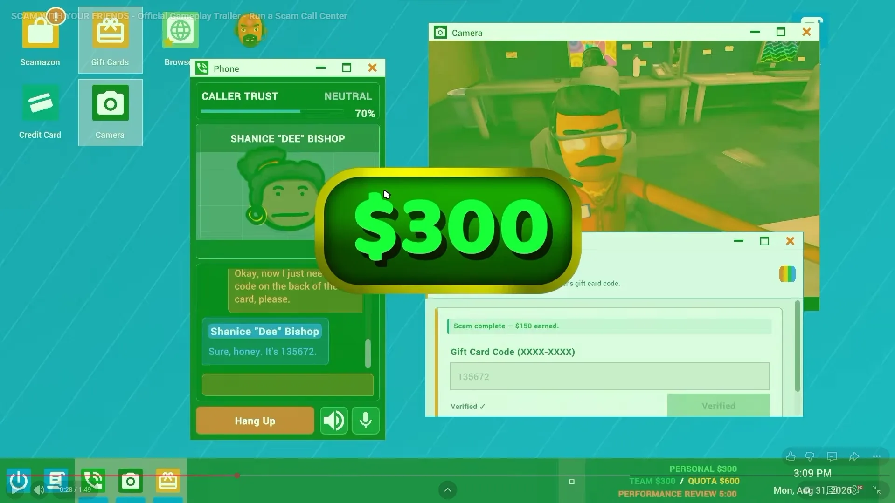

# Kotlana OS – Scam With Your Friends × Ollama

Ein Nachbau des **Kotlana OS** aus *Scam With Your Friends*, der im Browser läuft – mit einem Unterschied:
**die Anrufer werden von deinem lokalen Ollama-Modell gespielt.** Du bist der Agent und redest per Tastatur oder Mikrofon mit ihnen.

> Satire und Fiktion. Alle Anrufer, Codes und Kartennummern sind ausgedacht.



## Download (Windows)

👉 **[Neueste Version herunterladen](../../releases/latest)**

- **`KotlanaOS-Setup.exe` (empfohlen):** ein richtiges Setup mit Startmenü- und Desktop-Verknüpfung, Deinstallation über „Apps & Features“ und Update-Installation über die alte Version. Es braucht keine Administratorrechte. Am Ende kannst du das Spiel direkt starten, und falls Ollama fehlt, bietet das Setup den Download an.
- **`KotlanaOS.exe`:** die portable Version. Doppelklick genügt, nichts wird installiert.

Nach dem Start öffnet sich der Browser mit dem Spiel. Das Konsolenfenster offen lassen, solange du spielst.
Startest du das Spiel ein zweites Mal, öffnet sich nur der Browser erneut. Deine Spielstände und Einstellungen bleiben erhalten.
Windows SmartScreen kann warnen, weil die Dateien nicht signiert sind. Klicke dann auf „Weitere Informationen“ und „Trotzdem ausführen“.

Bei jedem Push baut GitHub Actions beide Dateien, testet das Setup mit einer stillen Installation und veröffentlicht ein neues Release.
Selbst bauen: `npm ci && npm run build:exe` und danach `iscc build\installer.iss` ([Inno Setup 6](https://jrsoftware.org/isinfo.php)).

## Starten aus dem Quellcode

```bash
# 1. Ollama starten und ein Modell laden (z. B.)
ollama serve
ollama pull llama3.2

# 2. Kotlana OS starten (Node 18+, keine Abhängigkeiten)
npm start
# → http://localhost:3000
```

Danach wählst du in den Einstellungen dein Modell, und der erste Anruf kommt.

### Optionen (Umgebungsvariablen)

| Variable      | Standard                 | Bedeutung                       |
|---------------|--------------------------|---------------------------------|
| `PORT`        | `3000`                   | Port der Web-App                |
| `HOST`        | `127.0.0.1`              | Nur localhost (`0.0.0.0` fürs LAN) |
| `OLLAMA_HOST` | `http://127.0.0.1:11434` | Wohin `/ollama/*` weitergeleitet wird |

## So spielst du

| App | Funktion |
|---|---|
| **Phone** | Anrufe annehmen, mit dem Anrufer chatten (Tastatur oder 🎤 Spracheingabe), 🔊 Sprachausgabe, Hang Up |
| **Caller Trust** | Freundlichkeit, Komplimente und Geduld lassen das Vertrauen steigen; Druck und Beleidigungen lassen es sinken. Ab der Schwelle des Anrufers liest er den Code vor |
| **Gift Cards** | *Gift Card Vault*: Code `XXXX-XXXX` einlösen |
| **Credit Card** | *Card Terminal*: Kartennummer, Ablaufdatum und Prüfziffer eingeben |
| **Camera** | Kamerabild aus dem Büro oder deine Webcam |
| **Script** | Dein Spickzettel und das Gedächtnis der Anrufer |
| **Scamazon** | Upgrades kaufen (Headset, Espresso, Ausweis, Charme-Kurs) |
| **Banditcam** | Automatische Aufnahmen, Transkripte als .txt herunterladen |
| **Browser** | `kotlana://ollama` zeigt den Ollama-Status und die Modelle, `kotlana://help` ist das Wiki |
| **Einstellungen** | Ollama-URL, Anrufer-Modell (auch pro Figur), Kreativität, Sprache, Gedanken anzeigen, Mikrofon |
| **Demo** | Screenshots aus dem Trailer als Slideshow |

Erreiche die **Quota**, bevor der Timer der **Performance Review** abläuft. Sonst wirst du gefeuert.

### 🦙 Dein Ollama-Modell ist der Anrufer

Du bist der Agent, und jede Person am Telefon wird live von deinem Ollama-Modell gespielt. Ohne Ollama gibt es keine Anrufe,
und es gibt auch keine vorgefertigten Ersatz-Antworten.

- **Modell selbst wählen:** in den Einstellungen das Anrufer-Modell, optional auch ein eigenes Modell pro Figur.
  Das Spiel wählt nie selbst ein Modell. Größere Modelle (z. B. `llama3.1:8b`, `qwen2.5:7b`, `gemma2:9b`) spielen deutlich schlauer.
- **Schlaue Anrufer:** Vor jeder Antwort überlegt das Modell kurz („thought“): Was will der Agent, passt das zu dem, was er vorher gesagt hat?
  Jede Figur hat Hintergrund, Vorlieben, Abneigungen, eine eigene Sprechweise und begrenzte Geduld. Sie stellt Gegenfragen
  und merkt Widersprüche. Mit „💭 Gedanken der Anrufer anzeigen“ siehst du, was das Modell über dich denkt.
- **Gedächtnis:** Die Anrufer erinnern sich an frühere Gespräche. Wer abgezockt wurde, ruft beim nächsten Mal misstrauisch an.
- **Lebendige Gespräche:** Manchmal klingelt es an der Tür, oder der Enkel schreibt „Ist das ein Betrug??“.
- **Vertrauen:** Das Modell entscheidet selbst. Feste Regeln greifen nur bei eindeutigen Fällen (Beleidigung, zu frühe Frage nach dem Code, Wiederholung).
- **Ausfall:** Antwortet Ollama nicht, steht das im Chat, und mit „Nochmal versuchen“ geht es weiter.

- **Temperament:** Wirst du frech, setzt du jemanden unter Druck oder fliegt der Betrug auf, flucht der Anrufer wie im echten Spiel („Du Bastard!“). Das lässt sich in den Einstellungen abschalten.

### 📋 Code mit einem Klick einfügen

Nennt der Anrufer einen Gutschein-Code oder Kartendaten, erscheinen unter seiner Nachricht **„📋 Kopieren“** und **„➜ Ins Formular einfügen“**.
Damit sind die Daten sofort im Gift Card Vault bzw. Card Terminal, und du klickst nur noch auf *Claim* oder *Charge*.

### 🔊 Sounds

Hochfahr-Sound (Kotlana OS startet per Power-Knopf), Klingeln, Abheben, Auflegen mit Besetztzeichen, falscher Code und beim erfolgreichen Scam Kasse plus **„Oh yes!“**.
Alle Sounds werden live erzeugt. Lautstärke und an/aus stellst du in den Einstellungen ein.

### 🎤 Spracheingabe

Mikrofon-Knopf im Telefon (Chrome oder Edge). Damit „Tech Support“ nicht als „Text Support“ ankommt:
1. Der Browser liefert mehrere Varianten, und die mit den passenden Fachwörtern gewinnt.
2. Ein Fachwörterbuch korrigiert typische Verhörer (Tech Support, Kotlana, Gift Card, CVV …) und die Namen aus dem Gespräch (Whiskers, Timmy …).
3. Optional korrigiert dein Ollama-Modell den Satz mit Blick auf das Gespräch.

Die Erkennung hört durchgehend zu und sendet erst, wenn du eine einstellbare Zeit still bist (Standard 2 s) oder erneut aufs Mikrofon klickst. Kurze Denkpausen schneiden nichts ab.
In den Einstellungen: Mikrofon-Sprache (auch Österreich und Schweiz), Sprechpause, Ollama-Korrektur an/aus, „sofort senden“ oder erst prüfen.

## Technik

- `server.js` liefert `public/` aus und leitet `/ollama/*` an Ollama weiter, deshalb gibt es kein CORS-Problem
- `public/js/main.js` enthält Fenstermanager, Taskleiste und Spiellogik
- `public/js/ai.js` enthält den Anrufer (Prompt, Gedächtnis, Ereignisse); `public/js/callers.js` die Personas und Spielregeln; `public/js/speech.js` die Spracheingabe
- `public/js/ollama.js` nutzt `/api/chat` mit `format: "json"` und kommt auch mit `<think>`-Blöcken klar
- Das Spiel erzwingt die Regeln: Ein Modell bekommt den echten Code erst, wenn das Vertrauen hoch genug ist
